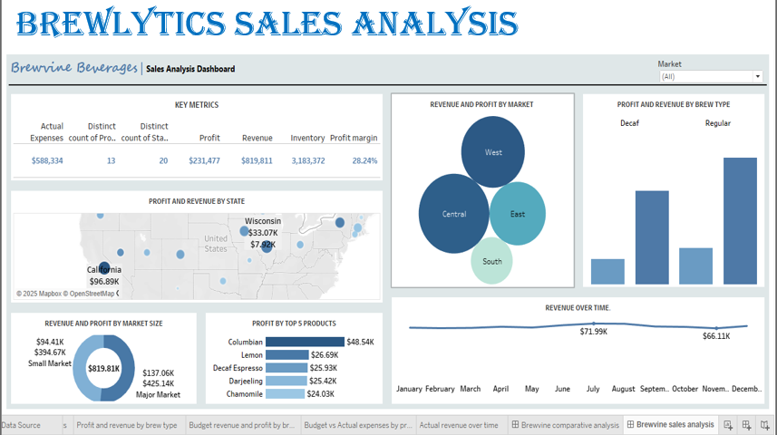
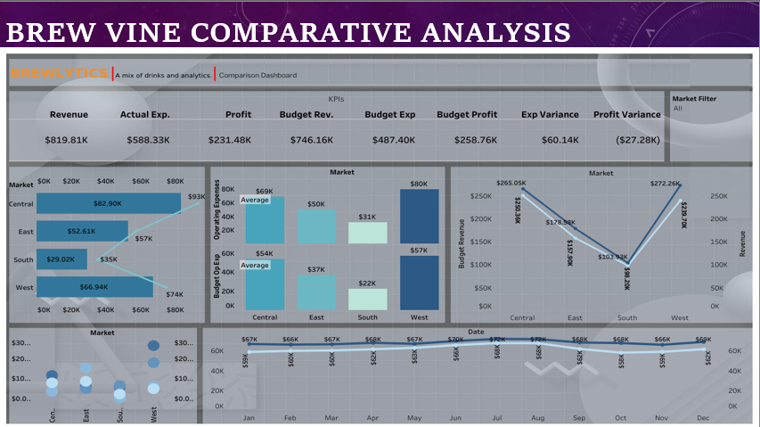
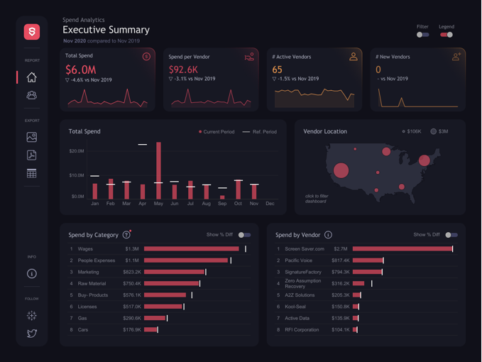

# Student Portfolio

A responsive portfolio and academic planner by **Onwuzurike Izuchukwu Constant**, a Data Science student at MIVA Open University. Explore my background, data-analysis projects, and a few of the tools I use to stay organised.

## Live site and repository

- **Live website:** [constant-portfolio-sooty.vercel.app](https://constant-portfolio-sooty.vercel.app/)
- **GitHub repository:** [Constant-Spioct/constant-portfolio](https://github.com/Constant-Spioct/constant-portfolio)

## Project overview

This static website brings together a personal introduction, academic and professional background, project work, and a browser-based study planner. The Projects page presents seven data-analysis projects separately from three illustrative learning concepts.

## Key features

The site has five pages:

- **Home** — Introduction, areas of interest, and links to the rest of the portfolio.
- **About** — Education, experience, career interests, developing skills, and an audio introduction.
- **Projects** — Data-analysis project cards and a separate section of illustrative concepts.
- **Academic Planner** — Create and manage study tasks, with due dates, filters, and task counts.
- **Contact** — Contact details and a form that validates input in the browser.

The shared navigation adapts to smaller screens. Planner tasks are saved in the current browser.

## Technologies

- **HTML5** for page structure and content
- **CSS3** for styling, layout, and responsive behaviour
- **JavaScript** for navigation, form validation, and planner interactions

## Visual preview

These existing dashboard images are among the project visuals displayed on the Projects page. Captions describe the content visible in each image.







## Project structure

```text
constant-portfolio/
├── index.html
├── about.html
├── projects.html
├── planner.html
├── contact.html
├── css/
│   └── style.css
├── js/
│   ├── main.js
│   ├── planner.js
│   └── contact.js
└── assets/
    ├── audio/
    │   └── portfolio-introduction.mp3
    └── images/
        ├── constant-home.jpg
        ├── constant-about.jpg
        ├── project-student.svg
        ├── project-sales.svg
        ├── project-expenses.svg
        └── dashboard images and other image assets
```

## Run locally

The site has no package installation or build step. From the project folder, start a local static server with Python:

```bash
python -m http.server 8000
```

Then open [http://localhost:8000](http://localhost:8000) in your browser. You can also use a static-server extension in your editor.

## Testing and functionality

No automated test suite is configured. The site can be checked in a browser by navigating through all five pages and trying the main interactions:

- Open and close the mobile navigation.
- Add a planner task, change its status, filter the list, delete a task, and reload the page to check browser-local persistence.
- Submit the contact form with invalid and valid values to see its validation feedback.
- Resize the browser to check the responsive layouts.

## Known limitations

- The contact form validates the name, email, phone number, and message, but **does not send or store messages**. A backend or form service would be needed to receive submissions.
- Planner tasks are saved only in the current browser's local storage. They are not shared across browsers or devices and may be lost if browser data is cleared.
- Google Fonts are loaded from an external service and may fall back to system fonts when offline.
```
## Technical Challenges & Solutions

During development, I encountered a few technical challenges while integrating website features and preparing the portfolio for deployment.

### 1. Audio Integration and Browser Compatibility

- **Challenge:** The audio introduction did not play when the website was opened directly from the local file system using the `file://` protocol.
- **Solution:**
  1. Used a relative file path to reference the audio file in the project directory.
  2. Tested the website through a local HTTP server to confirm that the browser could load and play the MP3 file.
  3. Retained the HTML5 audio controls so visitors can play, pause, and control the recording themselves.
  4. Tested the published audio player on GitHub Pages to confirm that the recording worked after deployment.

### 2. Responsive Dashboard Image Integration

- **Challenge:** Adding project dashboard screenshots without affecting the layout or making the project cards difficult to view on smaller screens.
- **Solution:**
  1. Integrated screenshots into their corresponding project cards.
  2. Applied responsive image styling to preserve their aspect ratios.
  3. Added descriptive alternative text and captions.
  4. Checked the Projects page on desktop and mobile screen sizes.

These improvements helped make the portfolio more accessible, consistent, and reliable across different viewing environments.

**Onwuzurike Izuchukwu Constant** · Data Science student at MIVA Open University · [GitHub profile](https://github.com/Constant-Spioct)
